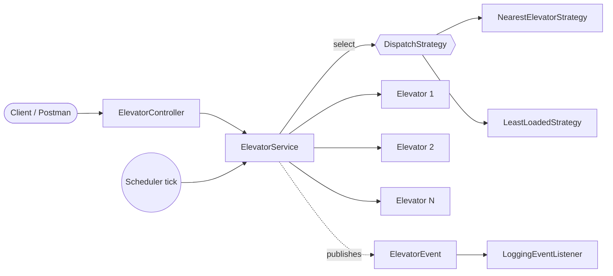

# Elevator System

A multi-elevator control system built with **Java and Spring Boot**.. It dispatches hall calls to the best elevator using pluggable strategies, and moves each car with a **LOOK/SCAN** scheduling algorithm, like a real elevator bank.


---

## Table of Contents

- [Features](#features)
- [Architecture](#architecture)
- [Design Patterns](#design-patterns)
- [Scheduling Algorithm](#scheduling-algorithm)
- [Project Structure](#project-structure)
- [Getting Started](#getting-started)
- [Configuration](#configuration)
- [API Reference](#api-reference)
- [Sample Output](#sample-output)
- [Error Handling](#error-handling)
- [Roadmap](#roadmap)
- [Author](#author)

---

## Features

- Multiple elevators managed by one controller
- Hall calls (UP/DOWN on a floor) and in-car floor selection
- Pluggable dispatch strategies: **nearest elevator** and **least loaded**
- LOOK/SCAN movement: stops are served in sweep order, with no back-and-forth
- Maintenance mode that takes an elevator out of dispatch
- Event-driven logging with Spring application events
- Input validation and consistent RFC 7807 error responses (`ProblemDetail`)
- Fully configurable through `application.properties`
- Thread-safe elevator state

---

## Architecture



**Request flow**

1. A client sends a hall call to `ElevatorController`.
2. `ElevatorService` validates the floor and asks the active `DispatchStrategy` for the best elevator.
3. The chosen elevator stores the stop in its sorted up or down set.
4. A scheduled **tick** moves every elevator one floor, and an `ARRIVED` event fires when a stop is reached.

---

## Design Patterns

| Pattern | Where | Why |
|---|---|---|
| **Strategy** | `DispatchStrategy` and its implementations | Swap dispatch algorithms without touching the service |
| **Factory** | `DispatchStrategyFactory` | Picks the strategy by name from configuration |
| **Observer** | `ElevatorEvent` and `LoggingEventListener` | Decouples logging and auditing from core logic |
| **Dependency Injection** | Spring beans throughout | Loose coupling and easy testing |
| **DTO** | `dto` package | API contracts stay separate from the domain model |

---

## Scheduling Algorithm

Each elevator keeps two sorted sets, `upStops` and `downStops`. It keeps moving in its current direction until no stops remain that way, then reverses or goes idle.

- A stop above the car goes to `upStops`, a stop below goes to `downStops`.
- Every tick moves the car one floor and removes the stop if it was requested.
- If the car is idle with stops in both directions, it heads toward the closer one.

**Dispatch cost (nearest strategy)**

- An idle car, or one already heading toward the request, costs the floor distance.
- Any other car costs the floor distance plus a penalty per pending stop.
- Elevators in maintenance are excluded.

---

## Project Structure

```
src/main/java/com/ElevetorySystem/ElevetorySystem
├── config        ElevatorProperties, SchedulingConfig
├── controller    ElevatorController
├── dto           Request, FloorSelectRequest, ElevatorStatusResponse
├── enums         Direction, ElevatorState
├── event         ElevatorEvent, LoggingEventListener
├── exception     Custom exceptions, GlobalExceptionHandler
├── model         Elevator
├── service       ElevatorService
├── strategy      DispatchStrategy, NearestElevatorStrategy,
│                 LeastLoadedStrategy, DispatchStrategyFactory
└── ElevetorySystemApplication.java
```

---

## Getting Started

### Prerequisites

- JDK 17 or later
- Maven 3.9+ (or use the included Maven wrapper)

### Run locally

```bash
git clone https://github.com/<your-username>/ElevetorySystem.git
cd ElevetorySystem
./mvnw spring-boot:run
```

On Windows use `mvnw.cmd spring-boot:run`.

The server starts on `http://localhost:8080`. A small demo runs on boot and submits a few sample requests so you can watch the elevator move in the console.

### Build a jar

```bash
./mvnw clean package
java -jar target/*.jar
```

---

## Configuration

`src/main/resources/application.properties`

```properties
elevator.min-floor=0
elevator.max-floor=10
elevator.elevators=3
elevator.strategy=nearest
elevator.tick-ms=1000
```

| Property | Description | Default |
|---|---|---|
| `elevator.min-floor` | Lowest floor | `0` |
| `elevator.max-floor` | Highest floor | `10` |
| `elevator.elevators` | Number of elevators | `3` |
| `elevator.strategy` | `nearest` or `least-load` | `nearest` |
| `elevator.tick-ms` | Simulation step in milliseconds | `1000` |

---

## API Reference

Base path: `/api/elevators`

| Method | Endpoint | Description |
|---|---|---|
| `POST` | `/request` | Hall call: assign the best elevator to a floor |
| `POST` | `/{id}/select-floor` | Inside-car call: add a destination floor |
| `GET` | `/status` | Live state of all elevators |
| `POST` | `/{id}/maintenance/{on}` | Enable or disable maintenance (`true`/`false`) |

### Hall call

```bash
curl -X POST http://localhost:8080/api/elevators/request \
  -H "Content-Type: application/json" \
  -d '{"floor": 5, "direction": "UP"}'
```

```json
{
  "id": 1,
  "currentFloor": 0,
  "direction": "IDLE",
  "state": "IDLE",
  "pendingStops": 1
}
```

### Select a floor inside an elevator

```bash
curl -X POST http://localhost:8080/api/elevators/1/select-floor \
  -H "Content-Type: application/json" \
  -d '{"floor": 9}'
```

### Status of all elevators

```bash
curl http://localhost:8080/api/elevators/status
```

### Put elevator 2 into maintenance

```bash
curl -X POST http://localhost:8080/api/elevators/2/maintenance/true
```

---

## Sample Output

```
--- Elevator System Booted ---
[Elevator 1] REQUEST_ASSIGNED at floor 5
[Elevator 1] REQUEST_ASSIGNED at floor 2
[Elevator 1] ARRIVED at floor 2
[Elevator 1] REQUEST_ASSIGNED at floor 10
[Elevator 1] ARRIVED at floor 5
[Elevator 1] ARRIVED at floor 10
```

The elevator serves floors 2, 5 and 10 in one upward sweep.

---

## Error Handling

Errors use the standard `ProblemDetail` format.

| Case | HTTP status |
|---|---|
| Floor outside the configured range | `400 Bad Request` |
| Invalid request body | `400 Bad Request` |
| Elevator ID not found | `404 Not Found` |
| All elevators in maintenance | `503 Service Unavailable` |

```json
{
  "status": 400,
  "detail": "Floor 25 is outside range 0..10"
}
```

---

## Roadmap

- [ ] State pattern for elevator states
- [ ] Capacity and overload handling
- [ ] Persistence of request history (Spring Data JPA)
- [ ] Unit tests with JUnit 5 and Mockito
- [ ] WebSocket live status feed
- [ ] Dockerfile and CI pipeline

---

## Author

**Vishal Singh**
B.Tech CSE, CSJMU Kanpur

Feel free to open an issue or a pull request.
